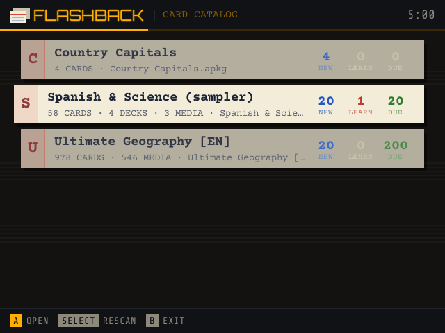
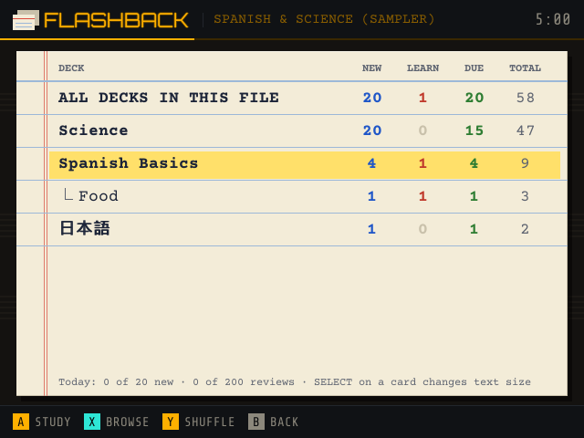
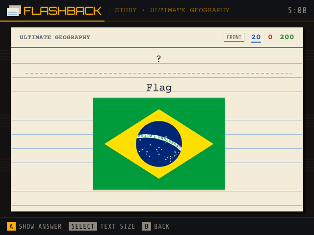
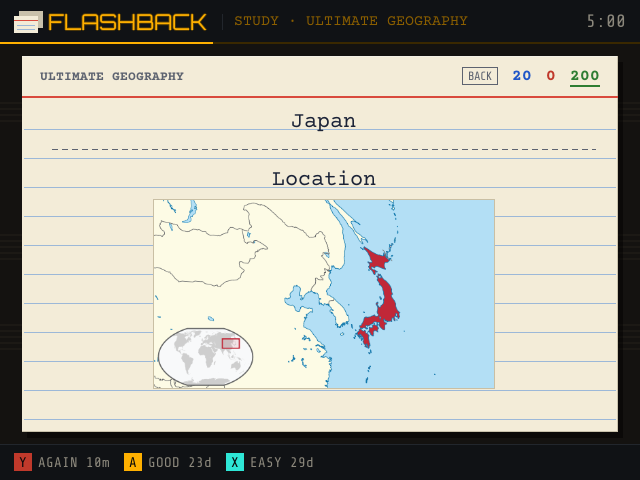
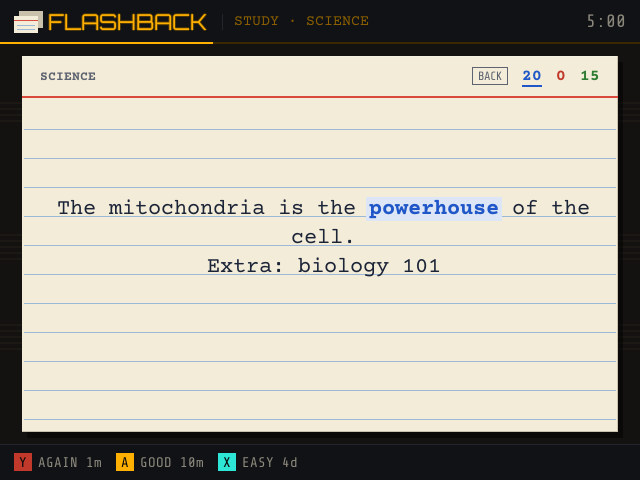
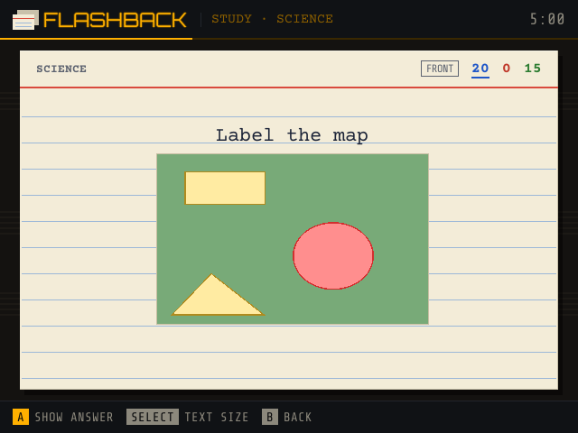
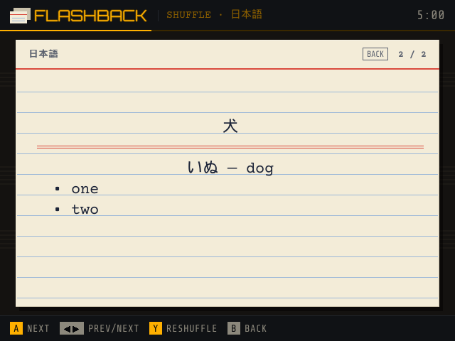
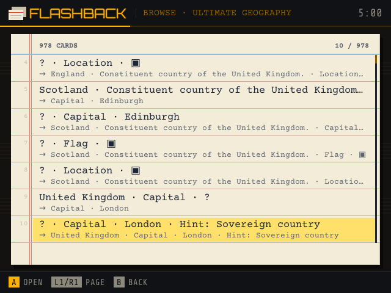

# FLASHBACK

**Anki flashcards for OnionOS on the Miyoo Mini Plus, and NextUI / NX Redux on TrimUI handhelds (Brick, Brick Pro, Smart Pro).** Flashback opens Anki deck files (`.apkg`), the shared decks from AnkiWeb or ones you export from Anki, and lets you study them with spaced repetition, browse every card, or shuffle through a pile. Cards are typed onto ruled index cards. Works offline; no account needed.

> 🤖 **Built by Claude.** Flashback was designed and written by [Claude](https://claude.ai), Anthropic's AI model, at the request of [@snyderman3000](https://github.com/snyderman3000) after someone asked for an Anki reader in [Mixtape](https://github.com/snyderman3000/mixtape). Claude wrote the code, the documentation and the artwork. It shares its display and input code with [Mixtape](https://github.com/snyderman3000/mixtape) and [Rewind](https://github.com/snyderman3000/rewind). Please report bugs through [Issues](https://github.com/snyderman3000/flashback/issues).

| | |
|---|---|
|  |  |
|  |  |
|  |  |
|  |  |

*Flag and map screenshots show the [Ultimate Geography](https://github.com/anki-geo/ultimate-geography) deck (CC BY 3.0). The other cards are test cards.*

## Features

- **Opens real Anki decks.** All three package generations: old `collection.anki2` (including decks made with genanki), `collection.anki21`, and the zstd-compressed `collection.anki21b` that current Anki exports. `.colpkg` collection backups work too.
- **Study with spaced repetition, scheduled by FSRS.** The same FSRS-6 model Anki offers (checked against the reference implementation): each card's stability and difficulty decide when it comes back, so you see it just before you'd forget it, at the recall rate you choose. New cards go through 1- and 10-minute steps first. **Again / Good / Easy**, with the next interval shown on each button; intervals get a little random spread, like Anki's. Sibling cards wait until another day. Daily limits for new cards and reviews; new cards in deck order or random; when reviews pile up, the ones you're most likely to have forgotten come first.
- **Settings on the device.** **START** on the catalog or deck list: new cards and reviews per day, target recall, longest interval, new card order, text size and sounds. ←→ changes a value, L1/R1 in big steps.
- **Browse** every card in a deck with question and answer previews, then flip through them one by one.
- **Shuffle** a deck and flip through it for quick practice, without touching your schedule.
- **Cards look like Anki's.** Note types and templates from the deck itself, conditionals, cloze deletions (with hints, nested clozes), type-in-the-answer cards, hints, furigana, bold/italic/colour, lists, simple tables, and pictures: PNG, JPEG, GIF, WebP, BMP and **SVG** (flags, diagrams). **Image occlusion** cards are drawn with their masks.
- **Every language.** Text is typed in Courier Prime; DejaVu Sans fills in Greek, Cyrillic, maths and symbols, and Japanese, Chinese and Korean use the CJK font OnionOS already has. Drop any other `.ttf`/`.otf` into `App/Flashback/fonts` to add a script.
- **Subdecks** as a tree, with new / learning / due counts for each.
- **Sound.** A card's sounds play when it's shown (on the answer side, only the ones the question didn't already play); **START** plays them again. Flashback hands them to the `ffplay` that OnionOS and NextUI already include, so decoding doesn't slow the app down.
- **Big decks are fine.** Each deck is unpacked once into a compact cache; after that it opens instantly and needs only a few MB of memory, even at 50,000 cards. Pictures are read straight from the `.apkg` when a card needs them, so nothing is copied twice. While you read one side of a card, the pictures of the side that comes next are decoded on the device's second core, so flipping is instant.
- **Index-card look.** Text sits on the card's ruled lines under a red header rule, cards flip over when you show the answer, deck files are pulled out of a card-catalog drawer, and decks are listed on a ledger sheet.

## Install

1. Download `Flashback-vX.Y.Z-OnionOS.zip` from [Releases](https://github.com/snyderman3000/flashback/releases).
2. Extract it and copy the `App` folder to the root of your SD card, merging it with the `App` folder already there.
3. On a computer, download decks from [ankiweb.net/shared/decks](https://ankiweb.net/shared/decks), or export your own from Anki (**File → Export → Anki Deck Package**).
4. Copy the `.apkg` files into the `Anki` folder at the root of the SD card. Flashback creates the folder the first time it runs, and also looks one folder level down.
5. Open **Apps → Flashback**.

AnkiWeb only lets signed-in users download shared decks, so decks are fetched on a computer rather than on the Mini. With no decks yet, Flashback shows these steps and a QR code for the shared-deck page.

Requires OnionOS 4.2 or newer (Miyoo Mini Plus or Mini Flip). No Wi-Fi needed.

**NextUI / NX Redux (TrimUI Brick, Brick Pro, Smart Pro):** use `Flashback-vX.Y.Z-NextUI.zip` instead, copy its `Tools` folder to the root of the SD card, and open **Tools → Flashback**. The controls are the same; the d-pad and shoulder buttons repeat when held.

## Controls

| Screen | Buttons |
|---|---|
| Card catalog | ↑↓ choose a file · ←→ / **L1/R1** page · **A** open · **START** settings · **SELECT** rescan · **B** exit |
| Decks | ↑↓ choose · **A** study · **X** browse · **Y** shuffle · **START** settings · **B** back |
| Settings | ↑↓ choose · ←→ change (**L1/R1** big steps) · **B** save and go back |
| Study | **A** show answer, then **Y** again · **A** good · **X** easy · ↑↓ scroll · **START** play sound · **SELECT** text size · **B** back |
| Browse | ↑↓ move · ←→ / **L1/R1** page · **A** open · **B** back |
| Card | **A** flip (next card in shuffle) · ←→ previous/next · **Y** reshuffle · ↑↓ scroll · **START** play sound · **SELECT** text size · **B** back |

MENU exits from anywhere. Progress is saved as you go.

## Settings

Most of these can be changed on the device (**START** on the catalog or deck list). They're kept in `App/Flashback/data/config.json` (created on first run):

| Key | Default | Meaning |
|---|---|---|
| `deck_folders` | `["/mnt/SDCARD/Anki"]` | Folders to look in for `.apkg` / `.colpkg` files |
| `new_per_day` | `20` | New cards introduced per deck file per day |
| `reviews_per_day` | `200` | Reviews per deck file per day |
| `text_size` | `22` | Card text size in pixels, 16–34 (**SELECT** on a card cycles through sizes) |
| `autoplay_audio` | `true` | Play a card's sounds when it's shown (**START** always plays them) |
| `desired_retention` | `0.9` | Recall rate FSRS aims for when a card comes back, 0.70–0.99. Higher means more reviews |
| `maximum_interval` | `36500` | Longest interval in days |
| `new_order` | `"deck"` | `"deck"` or `"random"` (a fixed shuffle of the whole file) |
| `fsrs_params` | — | 21 FSRS-6 parameters, e.g. optimized in Anki; leave out for the defaults |

## Good to know

- Progress from Flashback 0.3 and earlier (SM-2) carries over: each card's FSRS memory is estimated from its interval and ease the next time it comes up, the way Anki converts cards when FSRS is switched on.
- Flashback keeps its own progress in `App/Flashback/data/progress`, per deck **file name**. Replace a deck with an updated export of the same name and your progress carries over. It doesn't sync with Anki or AnkiWeb, and scheduling exported with a deck isn't imported.
- `data/cache` holds unpacked decks. It's safe to delete; it's rebuilt automatically.
- Maths written for MathJax (`\( … \)`) is shown as readable text with symbols, superscripts and subscripts (`F = (q₁ q₂)/(4πε₀ r²)`), not typeset equations.
- Some note types build the card with JavaScript (for example "Cloze Overlapping"). Flashback can't run that, so it shows the note's cloze text (or its fields) instead.
- Parts of a card that the note type's CSS hides (`display: none`) stay hidden, as on AnkiMobile/AnkiDroid — e.g. the tag list and the second copy of the cloze on AnKing cards. Buttons are left out, since there's nothing to click them with.
- Decks full of big photos (screenshots, scans) open cards slowly on the Mini's CPU, since each picture is decoded at full size and then shrunk. `tools/lighten` makes a copy whose pictures are no bigger than the screen shows them (544×188 on the Mini, 880×304 on a TrimUI Brick); cards and IDs are untouched, so copy it over the original (same file name) and your progress carries on. `go run ./tools/lighten -box 544x188 -in Deck.apkg -out light/Deck.apkg`
- Not supported yet: video, [latex] images, and the deck's own CSS beyond hiding, colours, sizes and bold/italic.

## Building

Needs Go 1.24 or newer.

```sh
./build.sh          # runs the tests, cross-compiles for ARMv7 (OnionOS) and arm64 (NextUI) and writes
                    # dist/Flashback-vX.Y.Z-OnionOS.zip and dist/Flashback-vX.Y.Z-NextUI.zip
go run . -shot study -out study.png   # render a screen on your computer (library, decks, study, answer, cloze,
                                      # occlusion, browse, view, japanese, flag, map, done, empty)
```

`go test ./...` checks package reading (all three formats), templates and cloze, the scheduler, the SVG renderer and the whole UI driven by button presses. The small test decks in `testdata/` were made with Anki's own library by `testdata/gen/make_sampler.py`. `make_ug.py` and `make_big.py` build larger decks (a real shared deck, and 50,000 cards) for the extra tests, which are skipped when those files are absent.

How it works: a small read-only SQLite reader and protobuf decoder (`sqlite.go`, `anki.go`) read the collection without cgo, so the app is a single static binary. `template.go` renders Anki's card templates, `layout.go` lays out the resulting HTML on a ruled card, `svg.go` rasterizes SVG images, `fsrs.go` is the FSRS-6 model and `scheduler.go` the study queues around it. `testdata/fsrs_golden.json` holds review histories made with py-fsrs; `go test` replays them to check every stability, difficulty and interval.

## License

MIT, see [LICENSE](LICENSE). Bundled fonts and libraries are listed in [THIRD_PARTY_NOTICES.md](THIRD_PARTY_NOTICES.md). Flashback is an independent app and isn't affiliated with or endorsed by Anki or AnkiWeb.
