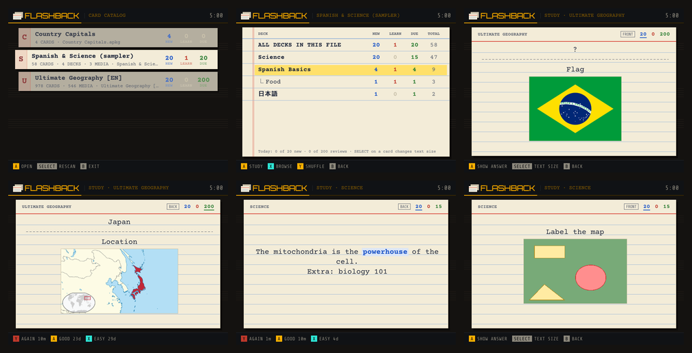

First release of **Flashback**: Anki flashcards on your Miyoo Mini Plus, typed onto ruled index cards.

### What it does
- **Opens Anki deck files** (`.apkg`, `.colpkg`): AnkiWeb shared decks or your own exports, old and new Anki formats alike
- **Study with spaced repetition:** Again / Good / Easy with Anki-style intervals, daily limits, progress saved as you go
- **Browse** every card with question and answer previews, or **shuffle** a deck and flip through it
- **Cards look like Anki's:** the deck's own templates, cloze deletions, type-in-the-answer, hints, furigana, formatting, pictures (including SVG flags and diagrams) and image occlusion
- **Any language:** Japanese, Chinese and Korean use the font OnionOS already has; add a `.ttf` to `App/Flashback/fonts` for anything else
- Subdecks with new / learning / due counts, and big decks open instantly after the first time

### Install
1. Download `Flashback-v0.1.0-OnionOS.zip` below.
2. Extract it and copy the `App` folder to the root of your SD card, merging it with the existing `App` folder.
3. On a computer, download decks from [ankiweb.net/shared/decks](https://ankiweb.net/shared/decks) (or export your own from Anki) and copy the `.apkg` files into the `Anki` folder at the root of the SD card.
4. Open **Apps → Flashback**.

Not supported yet: sound/video, MathJax/LaTeX. Flashback keeps its own progress and doesn't sync with AnkiWeb.

Requires OnionOS 4.2 or newer (Miyoo Mini Plus or Mini Flip).

🤖 Built by Claude (Anthropic) for @snyderman3000. Not affiliated with Anki or AnkiWeb. Please report problems in [Issues](https://github.com/snyderman3000/flashback/issues) and include `App/Flashback/data/flashback.log`.
